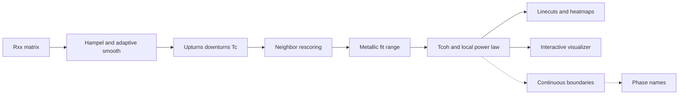

# Goal, scope, and progress

This is a status read of the repo as it stands on branch `some-tests` (same commit as `main`, `3de49c9`, 20 Aug 2026). Nothing here is a proposed code change.

## Goal

Automate the expert workflow that turns longitudinal resistance maps into a temperature–filling phase diagram for moiré WSe2.

The manual version, written up in [Phase_diagram_construction_E-103_v3.docx](Phase_diagram_construction_E-103_v3.docx) and used for Xia et al., Nature 650, 585 (2026), takes an expert about 2–3 days per displacement field. The AIMI SURP report ([AIMI SURP Report_byEric.docx](AIMI%20SURP%20Report_byEric.docx), 21 Aug 2026) sets the target: a deterministic pipeline that finishes in minutes, is reproducible, and is easy to review. The longer-term idea in that report is to wrap the pipeline as an agent skill: sweep tunable parameters, show candidate diagrams to an expert, and retune.

The pipeline is deliberately split in two. First extract features and temperature scales. Then assign phase names (Fermi liquid, strange metal, antiferromagnet, superconductor). Only the first half is being built in code. Phase names stay with a human, or a later agent, because the same power law means different things in different temperature windows. The physics those checks have to follow is written up in [phase-boundary-physics.md](phase-boundary-physics.md): which scales are transitions, which are crossovers, and when a proposed boundary is viable.

## Scope

In scope now:

- Eight displacement-field matrices in [source_data/](../source_data/): 74, 87, 96, 96.2, 99, 103, 151, and 176 mV/nm. Files are `Rxx_matrix_E-<field>mV_nm.csv` (temperature column, filling-factor headers, resistance matrix).
- Per linecut: clean and sort, Hampel filter, adaptive multiscale smoothing, local noise.
- Features: upturns and downturns (Néel-like extrema), superconducting `Tc` (resistance near zero, threshold 20), Fermi-liquid coherence `Tcoh` (10% departure from `ρ = ρ0 + A T²`), and strange-metal crossover `T′` (10% departure from a high-T linear fit into a sublinear regime).
- Local power-law fits `ρ(T) = ρ0 + A T^n`, plus neighbor-based rescoring so isolated noise peaks do not survive.
- Figures under `output/`, and a local linecut explorer at [scripts/phase_visualizer/](../scripts/phase_visualizer/).
- Reference labels from Nature Figure 3 for the four published fields (87, 96, 99, 103 mV/nm).

Out of scope so far, and stated as future work in the SURP report:

- Drawing continuous phase boundaries through the candidate points.
- A rule database that names phases from those features.
- Packaging the pipeline as an agent skill with human-in-the-loop parameter search.

The manual procedure also uses continuity on purpose: fit windows are shrunk from one anchor linecut to the next so `Tcoh` and `TN` fall smoothly. The current extractors score each linecut on its own and do not enforce that continuity.

## What is working

Library in [src/moire/](../src/moire/), driven by [scripts/general_pipeline.py](../scripts/general_pipeline.py) and [scripts/generate_figures.py](../scripts/generate_figures.py):

- Load, clean, smooth, and noise estimation.
- Scored upturns, downturns, and `Tc`, then iterative neighbor support in [src/moire/update_scoring.py](../src/moire/update_scoring.py) (3 passes × 5 iterations).
- Metallic extraction window in [src/moire/extract_behaviors.py](../src/moire/extract_behaviors.py), then `Tcoh` in [src/moire/extract_features.py](../src/moire/extract_features.py): expanding low-T `T²` windows kept only if the chi-square p-value is high enough, with the candidate at the first 10% departure of the smoothed curve. Confidence is that fit p-value.
- Local exponent fits in [src/moire/extract_power_law.py](../src/moire/extract_power_law.py).
- Static plots. About 1,800 linecut PNGs exist under `output/linecuts` and `output/dense_linecuts`, plus heatmap comparisons. The SURP report shows side-by-side diagrams for 103, 96, 74, 176, and 151 mV/nm.
- Interactive explorer: [scripts/phase_visualizer/](../scripts/phase_visualizer/) fits `ρ = ρ0 + A T^n` in Python and classifies superlinear / linear-compatible / sublinear from `n ± n_sigma`. An annotation page at `/annotate` can draw `Tcoh` and `T′` on the heatmap or mark individual linecuts.

`T′` exists as `extract_Tprime` in the same features module, with unit tests in [tests/test_extract_features.py](../tests/test_extract_features.py). It is not called by `general_pipeline.py` or `generate_figures.py`. The SURP report is still right that the main pipeline does not extract `T′`.

## Crossover experiment (separate from the library)

[crossover_analysis/](../crossover_analysis/) is a standalone trial added 19–20 Aug 2026. It does not modify `src/moire`. Each linecut proposes `Tcoh` and `T′` candidates from local fit quality, a persistent 10% departure, window agreement, and power-law contrast. Published Figure 3 markers are drawn only after scoring.

A later pass, [crossover_analysis/improved_tcoh.py](../crossover_analysis/improved_tcoh.py), keeps a candidate only if its score is at least 0.65 and within 0.10 of that linecut’s best score, at most four per linecut. Compared with the 45 published `Tcoh` anchors on 87, 96, 99, and 103 mV/nm (`crossover_analysis/paper_match_stages/validation_summary.json`):

- Stage 1 (up to five candidates): mean absolute error of the top candidate is about 0.36 K. The nearest candidate is about 0.12 K away. About 87% of anchors have some candidate within 0.2 K.
- Stage 2 (competitive retention): top-candidate error stays about 0.36 K. Nearest-candidate error rises to about 0.16 K, and recall within 0.2 K falls to about 80%. The published temperature is often in the candidate list and is often not the top score.
- 87 mV/nm is the closest field (top-candidate error about 0.16 K). 96 mV/nm is the worst (about 0.52 K).

No stage connects those points into a boundary. The README says that on purpose.

## Labels and review

[annotations/crossover_labels.json](../annotations/crossover_labels.json) (updated 20 Aug 2026) holds the published Figure 3 points:

- 103: 12 `Tcoh`, 7 `T′`
- 99: 12 `Tcoh`, 7 `T′`
- 96: 11 `Tcoh`, 7 `T′`
- 87: 10 `Tcoh`, no `T′` points in the file

Manual review is still open for 74, 96.2, and 176 mV/nm (empty boundaries, not marked reviewed). 151 mV/nm is in the pipeline and the SURP figures, and is absent from the annotation file. The only hand-entered linecuts are three `Tcoh` points on 74 mV/nm (ν ≈ 0.98, 0.997, 1.155).

## Ground truth for verification

The check set is the published Figure 3 symbols from Xia et al., taken from the Nature source-data workbook (`41586_2025_10049_MOESM4_ESM.xlsx`, panels e–h). The figure runs left to right at E = −103, −99, −96, and −87 mV/nm. The files use the same positive field ids as the pipeline: 103, 99, 96, and 87.

- [nature_figure3_ground_truth.csv](nature_figure3_ground_truth.csv) is the flat table.
- [nature_figure3_ground_truth.json](nature_figure3_ground_truth.json) is the same 117 points plus the source URL and the rounding rule.

| Field (mV/nm) | `Tcoh` | `TN` | `T′` |
| --- | ---: | ---: | ---: |
| 103 | 12 | 19 | 7 |
| 99 | 12 | 21 | 7 |
| 96 | 11 | 11 | 7 |
| 87 | 10 | 0 | 0 |

`Tcoh` and `T′` match [annotations/crossover_labels.json](../annotations/crossover_labels.json) exactly after rounding ν and T to three decimal places. `TN` is in the workbook and was not copied into that annotation file; the new table is the first copy of those Néel points. Panel h (87 mV/nm) publishes `Tcoh` only. An empty `TN` or `T′` list there means the paper did not plot that symbol, which is different from the unpublished fields 74, 96.2, 151, and 176, which have no Figure 3 reference at all.

Each row is `field_mV_nm`, `paper_E_mV_nm`, `panel`, `feature` (`Tcoh`, `TN`, or `Tprime`), `nu`, `T_K`, and `segment`. The workbook does not name the side. `segment` is `electron` when ν < 1 and `hole` when ν > 1, the same split already used for the disconnected `Tcoh` branches.

Use these points only after scoring. Compare an extracted temperature with the published point at the nearest filling. Do not feed ν or T from this table into the extractor.

Panels a–d of the workbook are resistivity samples for the color maps, and panels i–l are the `T²` coefficient A and the Hall density. Those are not phase-boundary labels, so they are not in this table.

## Where the working tree is today

`some-tests` has no commits beyond `main`. Uncommitted local work:

- [scripts/generate_figures.py](../scripts/generate_figures.py) now writes one “Extracted Features” heatmap per field into `output/new_tcoh/` instead of the old two-panel comparison, and the script’s entry point runs heatmaps rather than linecuts. Eight PNGs are already there (74, 87, 96, 96.2, 99, 103, 151, 176).
- Root `README.md` is deleted in the working tree. The same text is untracked at [project-specs/README.md](README.md), next to the SURP report and the E = −103 construction note.

## What does not work right now

These paths fail or disagree with the rest of the pipeline as the code is written today.

- The default four-panel linecut in [src/moire/draw_lines.py](../src/moire/draw_lines.py) (`plot_line_default`) is what [scripts/general_pipeline.py](../scripts/general_pipeline.py) saves. The bottom panel is labeled "Second Derivative" and is given `exponent_fit`, which is a dict of `rho0`, `A`, `n`, and `n_sigma` arrays. The plot helper expects a numeric series, so that panel does not draw. The feature overlays on the same figure are also wrong: the first call omits the temperature array, it looks up `features_rescored` (the rescoring step writes `features_new`), and the second call asks for the type `"Tcoh, T'"` as one string, so `Tcoh` and `Tprime` markers are skipped. Older PNGs under `output/linecuts/` are leftovers from before this function got out of sync.
- [scripts/generate_figures.py](../scripts/generate_figures.py) computes a Hampel-filtered curve and then smooths the raw resistivity instead. [scripts/general_pipeline.py](../scripts/general_pipeline.py) smooths the Hampel-filtered curve. The 14 Aug fix was about this exact mismatch throwing off the noise estimate and the resistivity scale, and the figure script is back on the raw curve.
- The current heatmap in `generate_figures.py` draws `features_new` and `features` on the same axes. `features_new` is the neighbor-rescored extrema and has no `Tcoh`. `Tcoh` is appended only to `features`, which still holds the original unrefined extrema. Each upturn, downturn, and `Tc` is therefore plotted twice, and `Tcoh` is plotted from the unrefined list.
- `extract_Tprime` is implemented and unit-tested, and neither main script calls it. The visualizer in [scripts/phase_visualizer/visualizer_math.py](../scripts/phase_visualizer/visualizer_math.py) also stops at upturns, downturns, and `Tc`.
- Linear, sublinear, and superlinear intervals are not part of the main run. `extract_behavior_fits` is only called from `scripts/test_Tcoh_extraction/`. `refine_behaviors` is an unfinished sketch: the second pass is still a comment, and a lone short interval at either end of the linecut indexes a neighbor that is not there.
- `BEHAVIOR_LEGEND_STYLE` in [src/moire/PLOTS_CONFIG.py](../src/moire/PLOTS_CONFIG.py) is the set `{""}` rather than a style dict. Nothing reads it yet.
- Root `README.md` is deleted in the working tree, while [pyproject.toml](../pyproject.toml) still sets `readme = "README.md"`. The same text sits untracked at [project-specs/README.md](README.md).
- Published `Tcoh` / `T′` boundaries are loaded for 87, 96, 99, and 103 mV/nm. Fields 74, 96.2, and 176 mV/nm are empty and unreviewed. 151 mV/nm is in the pipeline and missing from [annotations/crossover_labels.json](../annotations/crossover_labels.json).

## What works poorly

These paths run, and the temperatures or diagrams they produce are still a weak match to the manual workflow.

- On the 45 published `Tcoh` anchors, the highest-scoring candidate is about 0.36 K off on average. A candidate within about 0.12–0.16 K is often sitting in the same list. 87 mV/nm is the closest field (about 0.16 K). 96 mV/nm is the worst (about 0.52 K). Individual top picks on 96 and 99 mV/nm miss by more than 1 K. Tightening retention from five candidates to the competitive rule (score at least 0.65 and within 0.10 of that linecut's best) drops recall within 0.2 K from about 87% to about 80%.
- The library `extract_Tcoh` can keep up to 100 departures per linecut. The stored confidence is the chi-square p-value of the `T²` window, so a statistically comfortable fit can outrank the temperature that matches the paper. The 0.65 / 0.10 retention rule lives only in [crossover_analysis/improved_tcoh.py](../crossover_analysis/improved_tcoh.py).
- Both `Tcoh` extractors score one linecut at a time. Neighboring fillings, the shape of the heatmap, and a continuously shrinking fit window are unused. The SURP report and the E = −103 note both use those to decide an ambiguous crossover, and both say the boundary has to fall smoothly from anchor to anchor. The candidate clouds jump from filling to filling, and no code connects them into a boundary.
- `extract_Tc` emits up to three temperatures on every linecut wherever resistivity is at or below 20 Ω. The score measures how much of the colder side sits under that threshold. Those points then enter the same neighbor-rescoring loop as the Néel-like extrema, so a broad low-resistance region can be boosted the way a local minimum is.
- Regime labels in `extract_behavior_fits` cut a moving average of `n` at 0.8 and 1.2 and ignore `n_sigma`. Early linecut work found that a linear high-temperature stretch gets wobbling into sublinear and superlinear. The visualizer has a separate rule (`n ± n_sigma` against thresholds A and B), and it runs only after the phase panel is opened. `extract_local_fits` also fits the raw resistivity by default, while the rest of the pipeline is judging the smoothed curve.
- Low-temperature, resistivity-dependent noise and uneven temperature spacing are still the hard cases. 74 mV/nm has a dedicated debug notebook and branch, and only three hand-labeled `Tcoh` linecuts.
- The pipeline stops at markers. It does not name Fermi-liquid, strange-metal, antiferromagnetic, or superconducting regions, so the figures are not yet a phase diagram in the sense of the published Figure 3e.

## Still open

- Wire `T′` into the main pipeline the way `Tcoh` already is.
- Choose or merge candidates across a field so the top score tracks the published boundary more closely (nearest-candidate error is much smaller than top-candidate error).
- Draw continuous boundaries, including the manual continuity constraint on fit windows.
- Finish ground truth for 74, 96.2, 151, and 176 mV/nm. The four published fields now have a Figure 3 check set in [nature_figure3_ground_truth.csv](nature_figure3_ground_truth.csv).
- Name phases from the extracted scales.
- Turn the pipeline into the agent skill described in the SURP report.
